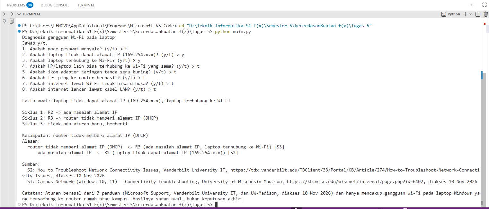
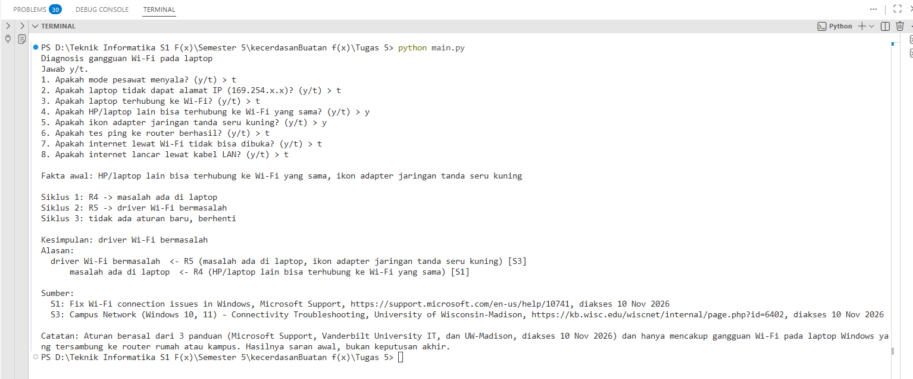
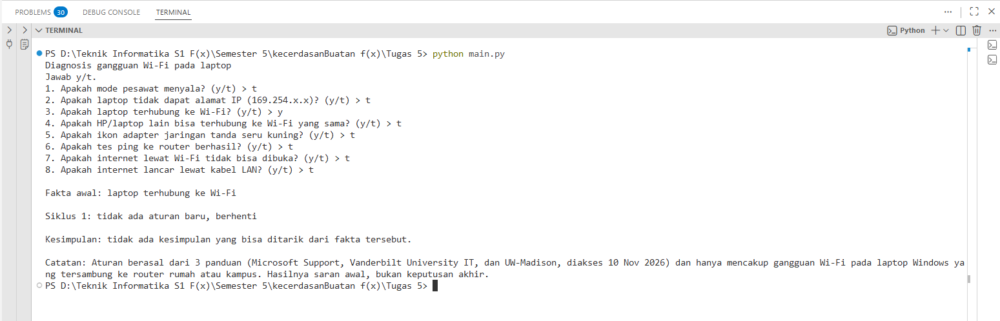

## 1. Nama dan NIM
- Muhammad Fathan Abdullah
- F1D02410124

## 2. Topik dan Cara Menjalankan
Topik: diagnosis gangguan Wi-Fi pada laptop Windows. Program menanyakan gejala, lalu menyimpulkan penyebabnya beserta alasannya.

- Bahasa: Python 
- Menjalankan (dari folder repo):
- Berkas: `codeX/main.py` (program), `codeX/kb_wifi.json` (aturan)

**Cara menjalankan:**
1. Unduh atau clone repo, lalu buka folder `codeX` di VS Code. Pastikan lokasi terminal sama dengan folder tempat `main.py` berada.
2. `main.py` dan `kb_wifi.json` harus berada di **satu folder yang sama**, karena program membaca aturan dari `kb_wifi.json` di folder tempat ia dijalankan.
3. Jalankan di terminal:
   ```
   python main.py
   ```

## 3. Sumber dan Tabel Aturan

| Kode | Sumber |
|------|--------|
| S1 | *Fix Wi-Fi connection issues in Windows*, Microsoft Support, https://support.microsoft.com/en-us/help/10741, diakses 10 Nov 2026 |
| S2 | *How to Troubleshoot Network Connectivity Issues*, Vanderbilt University IT, https://tdx.vanderbilt.edu/TDClient/33/Portal/KB/Article/274/How-to-Troubleshoot-Network-Connectivity-Issues, diakses 10 Nov 2026 |
| S3 | *Campus Network (Windows 10, 11) - Connectivity Troubleshooting*, University of Wisconsin-Madison, https://kb.wisc.edu/wiscnet/internal/page.php?id=6402, diakses 10 Nov 2026 |

| Aturan | IF | THEN | Sumber |
|--------|----|------|--------|
| R1 | mode pesawat menyala | Wi-Fi laptop nonaktif | S1 |
| R2 | laptop tidak dapat alamat IP (169.254.x.x) | ada masalah alamat IP | S2 |
| R3 | ada masalah alamat IP **DAN** laptop terhubung ke Wi-Fi | router tidak memberi alamat IP (DHCP) | S3 |
| R4 | HP/laptop lain bisa terhubung ke Wi-Fi yang sama | masalah ada di laptop | S1 |
| R5 | masalah ada di laptop **DAN** ikon adapter jaringan tanda seru kuning | driver Wi-Fi bermasalah | S3 |
| R6 | tes ping ke router berhasil **DAN** internet lewat Wi-Fi tidak bisa dibuka | modem atau ISP bermasalah | S1 |
| R7 | internet lancar lewat kabel LAN **DAN** internet lewat Wi-Fi tidak bisa dibuka | router Wi-Fi bermasalah | S1 |

Ada 7 aturan dan 5 kesimpulan akhir. Hasil satu aturan dipakai aturan lain pada R2 → R3 dan R4 → R5.

## 4. Metode: Forward Chaining
Forward chaining dipilih karena pengguna biasanya sudah tahu gejala yang terlihat, jadi penalaran bergerak dari fakta menuju penyebab. Program mulai dari fakta yang dijawab "ya", menjalankan aturan yang syaratnya terpenuhi dan hasilnya belum ada di memori, menambahkan hasilnya ke memori, lalu mengulang sampai tidak ada aturan baru.

## 5. Kasus Uji

| # | Jawaban "ya" | Kesimpulan |
|---|--------------|-----------|
| 1 | laptop tidak dapat alamat IP, laptop terhubung ke Wi-Fi | router tidak memberi alamat IP (DHCP) |
| 2 | HP/laptop lain bisa terhubung, ikon adapter tanda seru kuning | driver Wi-Fi bermasalah |
| 3 | laptop terhubung ke Wi-Fi saja | **tidak ada** (kasus negatif) |







## 6. Batas Keberlakuan
Aturan berasal dari tiga panduan (Microsoft Support, Vanderbilt University IT, dan UW-Madison, diakses 10 Nov 2026) dan hanya mencakup gangguan Wi-Fi pada laptop Windows yang tersambung ke router rumah atau kampus. Hasilnya saran awal, bukan keputusan akhir. Pernyataan ini juga ditampilkan program di akhir setiap konsultasi.

## 7. Penggunaan Alat Bantu AI
Claude (Anthropic) dipakai untuk membantu mencari sumber serta menyusun draf aturan, kode, dan README.
